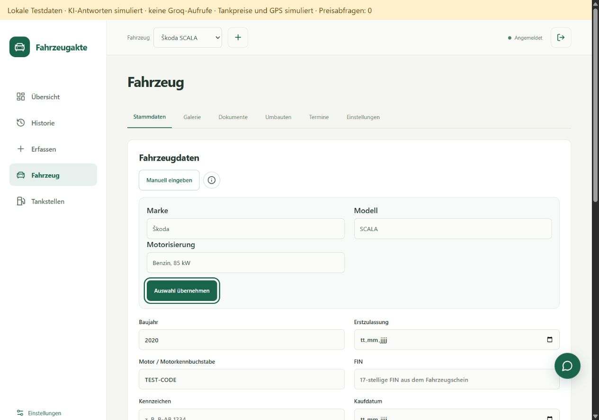
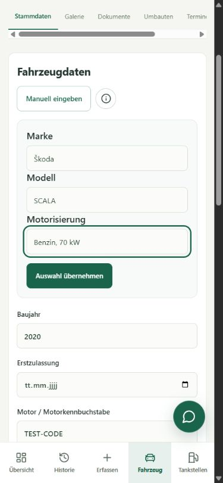

# Fahrzeugauswahl mit kostenlosen KBA-Daten

## Benutzung

Beim Hinzufügen eines Fahrzeugs:

1. Marke suchen, zum Beispiel `skoda`, und den Treffer auswählen.
2. Modell suchen und auswählen.
3. Motorisierung nach Kraftstoff und Leistung auswählen.
4. **Auswahl übernehmen** anklicken. Die übernommenen Angaben bleiben bearbeitbar.
5. Baujahr und gegebenenfalls den bestätigten Motorcode ergänzen und das Fahrzeug speichern.

Bei vorhandenen Fahrzeugen steht die Auswahl unter **Fahrzeug → Stammdaten → Fahrzeug auswählen**. Das Nachschlagen verändert keine gespeicherten Daten. Erst **Auswahl übernehmen** ändert den Formularentwurf; **Fahrzeugdaten speichern** speichert ihn. Baujahr, Motorcode, FIN, Kennzeichen und Kaufangaben werden vom Katalog nicht ersetzt.

**Manuell eingeben** ist jederzeit verfügbar, auch wenn eine Marke oder Variante fehlt oder der Katalog nicht geladen werden kann. Eine manuelle Änderung an Hersteller, Modell, Kraftstoff oder Leistung entfernt die Quellenzuordnung des Entwurfs. Die Auswahl lässt sich mit Tastatur, Maus und auf dem Handy bedienen.

## Daten und Grenzen

Stand: **1. Januar 2026**. Der ausgelieferte Katalog enthält **60 Herstellergruppen, insgesamt 4.311 Modellbezeichnungen und 10.891 Kombinationen aus Kraftstoff und Leistung**. Beim Scala sind unter anderem Benzinvarianten mit 70, 81, 85 und 110 kW enthalten.

- FZ 2, Blatt FZ 2.2, liefert Pkw-Hersteller, Handelsnamen, TSN, Kraftstoffcodes und kW. Leere Gruppenfelder werden entsprechend der Tabellenstruktur fortgeführt.
- FZ 6, Blatt FZ 6.1, ergänzt HSN nur bei einer einzigen Übereinstimmung aus Hersteller, TSN und Handelsname. Mehrdeutige Treffer werden nicht übernommen. TSN und ursprüngliche Herstellerbezeichnung aus FZ 2 bleiben erhalten.
- Gleichartige Kombinationen werden zusammengefasst; die ursprünglichen Typverweise bleiben erhalten. Unterschiedliche Handelsnamen werden nicht zu vermeintlichen Baureihen zusammengeführt.
- Quelle: **Kraftfahrt-Bundesamt, Flensburg**. Für die Auswahl aufbereitet, gruppiert und in getrennte Dateien je Marke umgewandelt.
- Lizenz: [Datenlizenz Deutschland – Namensnennung – Version 2.0](https://www.govdata.de/dl-de/by-2-0). Downloadadressen und SHA-256-Prüfsummen stehen im Katalogmanifest.

Dies ist eine amtliche Bestandsstatistik, kein vollständiger Ersatzteilkatalog. Neue Modelle nach dem Stichtag, seltene Typen, Importe und nicht separat ausgewiesene Fahrzeuge können fehlen. Handelsnamen können abgekürzt sein oder mehrere Bezeichnungen enthalten. HSN/TSN und statistischer Stichtag sind weder ein Motorkennbuchstabe noch das Baujahr.

Einige Markennamen stehen unter KBA-Herstellergruppen. Die Suche nach Mercedes-Benz findet beispielsweise auch **DAIMLER (Mercedes-Benz, smart, Maybach)**, die Suche nach MINI auch **BMW (MINI)**. Die Suchnamen ordnen einem einzelnen Modell keine Marke zu: Übernommen wird die Herstellerbezeichnung der Quelle. Sie kann im Formular manuell geändert werden. Platzhalter für fehlende Modellnamen werden nicht als auswählbares Modell angeboten.

Motorkennbuchstaben, Hubraum, Produktionszeitraum und Bezeichnungen wie „1.0 TSI“ werden nicht abgeleitet. `G` wird als **Gas** angezeigt; zwischen Erdgas und Flüssiggas wird daraus nicht geraten. Bei Hybridfahrzeugen kann die ausgewiesene Leistung nur den Verbrennungsmotor betreffen. Unbekannte Kraftstoffcodes oder fehlende Leistung bleiben leer.

## Hosting und Speicherung

Der öffentliche Katalog liegt als **61 statische JSON-Dateien** unter `/vehicle-catalog/`, insgesamt rund **1,9 MB**. Der Browser lädt zunächst das kleine Markenverzeichnis und danach nur die ausgewählte Marke. Bereits geladene öffentliche Katalogdaten werden während der Sitzung wiederverwendet. Nach einem fehlgeschlagenen Markenabruf kann „Erneut laden“ auch ein aktualisiertes Manifest holen.

Die vorhandene Pages-Konfiguration ruft Functions ausschließlich für `/api/*` auf. Katalogabrufe benötigen keine Worker-Ausführung, D1-Abfrage oder R2-Datei. Für statische Abrufe berechnet Cloudflare derzeit keine Gebühren. Die Grenzen von 20.000 Dateien und 25 MiB pro Datei im Pages-Free-Tarif werden vor der Veröffentlichung für das **gesamte Website-Paket** geprüft.

Im jeweiligen Fahrzeug werden nur die ausgewählten Angaben und die optionale Quellenreferenz gespeichert. `Vehicle.power_kw` und `Vehicle.catalog_reference` sind optional und werden serverseitig geprüft. Bestehende Speicheraktionen und Kontentrennung bleiben bestehen. Export und Wiederherstellung erhalten die neuen Angaben; ältere Sicherungen benötigen sie nicht. Der JSON-Vertrag v1 wird nicht geändert.

**Keine zusätzliche D1-Migration, keine neuen Schlüssel und keine Kontoeinstellungen erforderlich.** Commit und Push erfolgen wie bisher in GitHub Desktop. Der Push auf `main` veröffentlicht Website und Worker gemeinsam.

## Katalog kontrolliert aktualisieren

Der normale Build verwendet den versionierten Katalog und lädt keine Quellen aus dem Internet nach.

```powershell
pnpm catalog:import 2026
```

Der Import verwendet lokal zwischengespeicherte Originale aus `.cache/kba/`. Für einen erneuten Abruf desselben Jahres:

```powershell
pnpm catalog:import 2026 --refresh
```

Für einen neuen Jahresstand wird die Jahreszahl angepasst. Das Skript prüft Tabellenblätter, Spalten, Stichtag, erwartete offene Lizenz und Grundvollständigkeit. Bei Download- oder Prüfungsfehlern bleibt das bisherige Manifest bestehen. Die Quelldateien liegen ausschließlich im ignorierten lokalen Cache; ihre Prüfsummen werden im Manifest dokumentiert.

Nach dem Import die Katalogänderungen prüfen, Tests und Build ausführen und erst danach Commit und Push vornehmen. Kein automatischer jährlicher Import oder zusätzlicher Cloudflare-Zeitplan.

## Lokale Abnahme am 30.10.2026

331 Tests in 25 Testdateien sowie Typprüfung, Produktionsbuild und Abhängigkeitsprüfung erfolgreich. Das komplette veröffentlichbare Website-Paket enthält 302 Dateien und bleibt innerhalb der geprüften Pages-Free-Dateigrenzen.

- Automatisiert: XML-/XLSX-Verarbeitung, führende Nullen, unbekannte Werte, mehrdeutige HSN-Zuordnung, echte Scala-Daten, Prüfsummen und getrennte Markendateien.
- Oberfläche: Tastatur, Suche ohne Sonderzeichen, manuelle Eingabe, bewusste Übernahme, Erhalt anderer Fahrzeugangaben, Ladefehler, Wiederholung und verspätete Antworten.
- Speicherung: Anlegen und Ändern, erneutes Laden, getrennte Konten/Fahrzeuge, serverseitige Ablehnung ungültiger Werte und Wiederherstellung mit Quellenreferenz.
- Browser: Desktop 1280 × 900 und mobile Ansicht 390 × 844. Fahrzeug über Katalog angelegt, neu geladen und anschließend im bestehenden Formular geändert. Nur synthetische lokale Konten und Daten.
- Cloudflare-Laufzeit lokal: bestehende Prüfungen mit 100, 1.000 und 3.000 verknüpften Einträgen bestanden; Bootstrap ca. 85–90 ms, kleine Änderung ca. 24–32 ms. Das sind lokale Wandzeiten, keine Messung produktiver CPU-Kontingente.
- Produktionsbuild und Artefaktprüfung einschließlich Pages-Dateigrenzen. Eine bereits bestehende Vite-Warnung zu großen JavaScript-Paketen bleibt bestehen; der Katalog selbst ist kein Bestandteil des JavaScript-Pakets.




